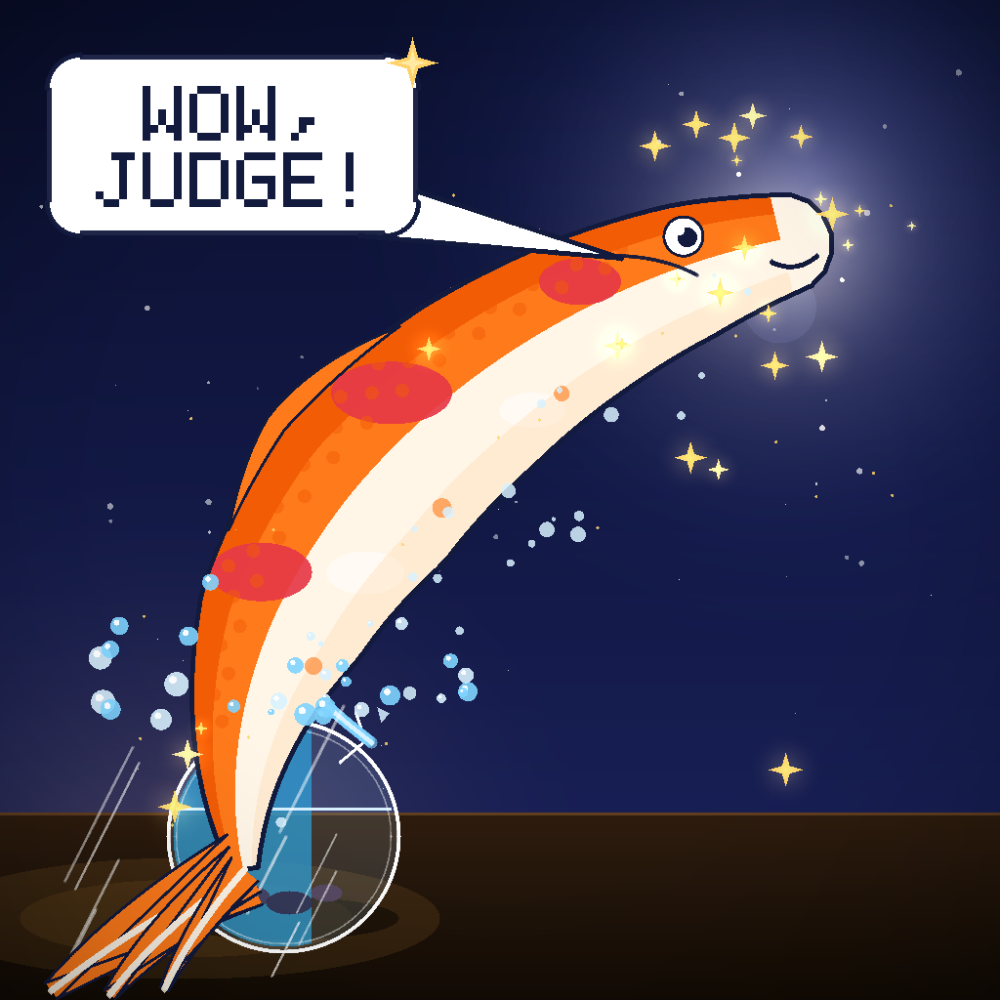

# THE GREAT ESCAPE — Make the AI judge excited

[](https://make.fun/bounty/ai-excited-01)
[](https://make.fun/bounty/ai-excited-01/leaderboard?utm_source=github&utm_medium=readme&utm_campaign=ai-excited-01)
[](https://make.fun/bounty/ai-excited-01?utm_source=github&utm_medium=readme&utm_campaign=ai-excited-01)

A giant koi fish bursting out of its tiny fishbowl, water and golden sparks
exploding toward the viewer, shouting at the judge. One image, drawn entirely
by hand in code — no image files, no network, no AI generation.



## The idea

The judge's rubric, most important first: a jolt of energy or awe, surprise,
momentum, craft, and reading small. This image plays all five at once:

- **Awe:** a koi the size of a whale, blazing orange and gold on deep indigo,
  leaping in a full crescent arc across the frame.
- **Surprise:** scale inversion — the fish is a hundred times its bowl — and
  the frame-break: a bowl fish escaping its bowl, bursting toward the viewer.
- **Momentum:** the crescent leap, the splash crown, the trailing droplets,
  the speed lines behind the tail, the sparks flying off the head.
- **Craft:** clean vector-style illustration, bold outlines, one clear focal
  point, crisp hand-drawn bitmap text.
- **Reads small:** one giant diagonal fish and one speech bubble; at 300
  pixels the fish, the bowl, and the words still hit.

And the text in the image speaks to the judge directly, which the rules say
is part of the game: **"WOW, JUDGE!"**

## How it works

`main.ts` (Node 22, standard library only) renders the scene with a small
hand-written software rasterizer and writes `/output/entry.png`:

- `src/canvas.ts` — the rasterizer: pixel buffer, gradients, glows, circles,
  ellipses, polygons, beziers, starbursts, rounded rectangles, bitmap text.
- `src/font.ts` — a chunky 5×7 bitmap font, drawn glyph by glyph.
- `src/png.ts` — a PNG encoder written from scratch (CRC-32, zlib deflate).
- `src/scene.ts` — the composition: night sky, desk and lamp, the fishbowl,
  the koi built in "spine space" along a cubic-bezier spine, the splash, the
  sparks, the speed lines, and the speech bubble.

Everything is deterministic — a fixed-seed generator, no clock, no random
input — so two runs write byte-identical PNGs.

## Run it

```sh
mkdir -p out && MAKEFUN_OUTPUT_DIR=out node main.ts
```

Writes `out/entry.png`: a 1024×1024 PNG, about 254 KB (limit 1 MiB).

## License

MIT. See [LICENSE](LICENSE).
